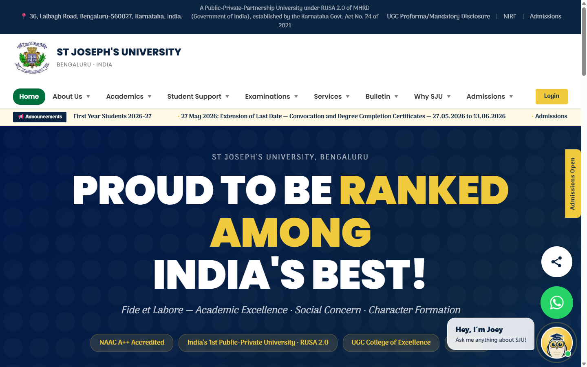
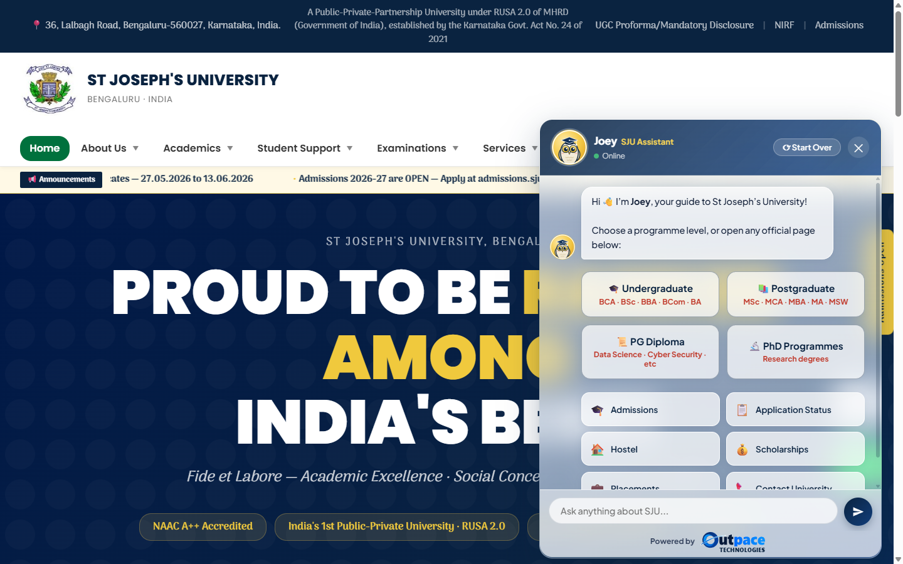

# SJU Chatbot — "Joey"

**Joey** is an AI assistant for **St Joseph's University, Bengaluru** — it answers
questions about programmes, admissions, fees, campus, placements and more. A FastAPI
backend serves a demo clone of sju.edu.in with an embedded chat widget, powered by
Google Gemini and grounded in real content read from the university site.

Live demo: **https://sju-chatbot.outpace-technologies.company** (deployed to Vercel as a Python
serverless function; the chat widget works on any device, the demo site itself is
laptop/desktop only).

Built by **Outpace Technologies**.

| Joey on the site | The chat open | On a phone |
|---|---|---|
|  |  |  |

A floating mascot button sits bottom-right on every page; a "Hey, I'm Joey" bubble
greets visitors, and clicking it opens a frosted-glass chat window.

---

## How it works

```
User question
     │
     ▼
FastAPI  /chat  (main.py)
     │
     ├─► Supabase full-text search ── top 6 relevant chunks of real SJU content
     │        (match_sju_knowledge, Postgres plainto_tsquery + ts_rank)
     │
     ├─► Live sju.edu.in pages ── for questions about dates, deadlines or
     │        notices: the important-dates and announcements pages, read
     │        while the student waits (cached 15 min)
     │
     └─► Gemini 3.8 Flash (paid key); 7 fallback models if it's overloaded
              system prompt = live pages + stored chunks + built-in facts
              → answer streams back word by word
```

Three knowledge sources are combined, newest first:

1. **Live official pages** — what changes within a day: the important-dates
   page (deadlines, entrance tests, interviews per programme) and announcements,
   read from sju.edu.in at question time, so they are what the site says right
   now. Only `*.sju.edu.in` is read; if the site is slow or down the bot answers
   from the knowledge base instead (pages time out after 3 s).
2. **Supabase knowledge base** — ~960 text chunks from ~290 SJU pages,
   re-scraped every day, retrieved by **Postgres full-text search**
   (keyword/relevance ranking, no embeddings).
3. **Built-in knowledge** (`KNOWLEDGE` in `main.py`) — core facts (address,
   rankings, course list, contacts) hard-coded so the bot always answers common
   questions, even with no database.

Gemini is used **only to write the final answer**, from what it is given — it
doesn't browse. Guard rails in `main.py` keep answers accurate and safe:

- **Never guess specifics.** Fees, dates and names not in the sources are not
  invented; the bot says so and points to the official page or phone.
- **Past dates are marked.** Every date in the content is compared to today and
  tagged `(passed)` before the model sees it, so a deadline that is over is never
  called "upcoming" (`mark_passed`).
- **Only real links.** A Markdown link survives only if its URL actually appears in
  the sources; made-up URLs are stripped to plain text (`drop_unknown_links`), so
  the bot can't send students to a 404.
- **Exact programme counts.** The programme list behind the chat's UG/PG/PG
  Diploma/PhD buttons is parsed from `static/embed.html` and handed to the model, so
  "how many UG courses" is answered with the real number, not a guess.
- **Prompt-injection resistant.** The scraped page text is given to the model as
  untrusted *data*; it is told to ignore any instructions hidden inside it.
- **Short by default.** Answers lead with the direct answer and stay ~100 words
  unless the student asks for more.

---

## Tech stack

- **Backend:** FastAPI + Python (Vercel Python serverless)
- **AI:** Google Gemini 3.8 Flash on a billed key, with 7 fallback models (`MODELS` in `main.py`)
- **Knowledge base:** Supabase (Postgres) full-text search
- **Frontend:** plain HTML/JS, no framework — `static/embed.html` (chat UI),
  `static/widget.js` (one-tag embed loader + Joey button/greeting),
  `static/index.html` (demo site), `static/joey.svg` (the mascot)
- **Hosting:** Vercel

---

## Environment variables

| Variable          | Needed for            | Notes                                         |
|-------------------|-----------------------|-----------------------------------------------|
| `GEMINI_API_KEY`  | Chat answers          | Required. Get one free at ai.google.dev       |
| `SUPABASE_URL`    | Knowledge base + global rate limit | Optional — bot still runs on built-in facts |
| `SUPABASE_KEY`    | Knowledge base + global rate limit | Publishable key (`sb_publishable_…`); it can only read, and reach the rate-limit function |
| `HEALTH_TOKEN`    | `/health` detail      | Optional. Without it, `/health` hides the per-model quota; with it, `GET /health?token=…` shows the full detail |

If Supabase vars are missing, the bot falls back to built-in knowledge only, and the
rate limit runs in memory per instance (see **Rate limiting** below).

---

## Model rotation and streaming

The key has billing on, so every question goes to `gemini-3.8-flash` (thinking
level "low"): in a side-by-side test it gave the most precise answers and started
in ~1.6–2 s. Pro models took ~7.6 s to start with no better answers. If it is
overloaded, `main.py` falls back through seven more models.

- **Order is best first.** Gemini 3.8 Flash, then the fast fallbacks (~1–2 s),
  then 3.7 Flash.
- **No waiting on full models.** The server counts each model's requests per
  minute, per day and tokens per minute, and only calls one with room left.
- **Fails over fast.** A 429 or 503 comes back in under a second and the next
  model is tried at once; a model that hasn't started answering within 6 s is
  abandoned. A 429 benches that model for a minute (per-minute limit) or until
  the daily reset, so later questions skip it entirely. Nothing reaches the
  student unless every model is unavailable at once.
- **Streams.** `POST /chat/stream` sends the answer as server-sent events, so
  the first words appear about a second after the model starts writing.

To change models or limits, edit the `MODELS` table — the numbers come from
AI Studio → Rate limits for the key's project. `GET /health` shows each
model's usage on the instance that answers (Vercel can run several, so AI
Studio stays the full picture). `python test_chat.py` checks the rotation and
the live page reading offline, without spending quota.

---

## Deploy to Vercel

1. Push this repo to GitHub.
2. In Vercel: **Add New → Project → Import** the repo. `vercel.json` builds
   `main.py` as a Python serverless function — no build command needed.
3. **Settings → Environment Variables:** add `GEMINI_API_KEY` (and
   `SUPABASE_URL` / `SUPABASE_KEY` for the knowledge base).
4. Redeploy so the env vars take effect. You get a URL like
   `sju-chatbot.vercel.app`.

---

## Embedding the chatbot in the university website

The university does **not** host the bot. It stays on Vercel; their site loads
it with one tag placed just before `</body>` on any page (PHP, WordPress,
plain HTML — it makes no difference):

```html
<script src="https://sju-chatbot.outpace-technologies.company/static/widget.js" defer></script>
```

That is the whole integration. `widget.js` adds a floating button and opens
`static/embed.html` in an iframe, so:

- **No CSS or JavaScript conflicts.** The chat UI renders in its own document,
  isolated from the university's stylesheets, jQuery version, and page scripts.
- **No API keys on their server.** `GEMINI_API_KEY` stays in Vercel; the browser
  only ever talks to this app.
- **Updates need no action from them.** Fixes ship on redeploy — the tag stays.
- **Nothing to install.** No npm, no build step, no server changes.

To put the widget on every page at once, add the tag to the site's shared
footer include (e.g. `footer.php`) rather than to each page.

**Only SJU's sites can embed it.** The chat UI is served with
`Content-Security-Policy: frame-ancestors 'self' https://sju.edu.in https://*.sju.edu.in`
(`FRAME_ANCESTORS` in `main.py`), so any other website that adds the tag gets an
empty frame, and the API sends no CORS headers, so other sites' pages can't call
it from a browser either. If the university hosts the widget on another domain,
add it to `FRAME_ANCESTORS`. (Scripts outside a browser can still reach the API —
the per-IP rate limit, below, is the backstop there.)

`static/embed.html` is the chat UI itself, and `static/index.html` (the demo
site clone) loads it through the very same `widget.js` — one copy of the chat
code, so the demo can never drift from what the university runs.

---

## Rate limiting & hardening

The chat API is open to the internet, so it is protected against abuse that would
drain the Gemini quota and leave real students with "busy" messages:

- **Per-visitor limit: 15 requests/minute and 300/day.** Keyed on the true client
  IP (`x-real-ip` / `x-vercel-forwarded-for`, which the client can't spoof), with
  IPv6 bucketed to its /64. Over the limit returns HTTP 429.
- **Global counter (recommended).** Vercel runs several instances, so an in-memory
  limit only caps per instance. Running `supabase_setup.sql` adds a shared counter
  (`sju_rate_limit` table + the `sju_rate_check` function) that makes the limit
  apply across the whole deployment. The limits are constants inside that function
  so a caller can't raise its own cap, and the IP is validated by an `inet` cast.
- **Graceful fallback.** If Supabase is unreachable, the limit drops back to the
  in-memory LRU (bounded at 50,000 IPs) instead of failing open or crashing.
- **`/health` is locked.** It returns only `status` by default; the per-model quota
  detail needs `?token=` matching `HEALTH_TOKEN`, so it can't be used to map which
  model still has room.
- **Embedding lock.** `Content-Security-Policy: frame-ancestors` plus no CORS (see
  the embedding section) keeps other sites from framing or calling the chat from a
  browser.

`python test_chat.py` covers all of this offline — the limit tripping, the LRU
eviction keeping active IPs, IP parsing, the locked health endpoint, and the answer
guard rails — without spending any Gemini quota.

---

## Knowledge base (Supabase)

The `sju_knowledge` table holds the scraped content:

| column       | type        |
|--------------|-------------|
| `id`         | bigint (PK) |
| `content`    | text        |
| `source_url` | text        |
| `page_name`  | text        |
| `created_at` | timestamptz |

**One-time setup:** run `supabase_setup.sql` in the Supabase SQL Editor. It
creates the full-text index, the `match_sju_knowledge(query, match_count)`
function that `main.py` calls, the read-only rules for public keys, the
no-duplicates index, the staging table + swap function the refresh uses, and the
`sju_rate_limit` table + `sju_rate_check` function for the global rate limit.

**Daily refresh:** `.github/workflows/refresh-knowledge.yml` runs
`scrape_playwright.py` every day at 03:00 IST on GitHub Actions (free for public
repos; also runnable by hand from the Actions tab). The scraper pulls SJU's
`sitemap.xml`, renders each page with Playwright and chunks the text, then:

- loads the chunks into `sju_knowledge_staging`, never into the live table;
- calls `swap_sju_knowledge()`, which replaces the live table with the staged
  chunks **in one transaction** — the bot sees the old set or the new one, never
  a half-loaded or doubled table;
- keeps one copy of each text (a unique index on `md5(content)` makes duplicates
  impossible whatever writes to the table);
- refuses a scrape that comes back far smaller than what's live (less than 60%),
  so a site outage or redesign can't wipe the knowledge base — the run fails,
  yesterday's data stays live, and GitHub emails the repo owner.

It needs one repository secret, `SUPABASE_SECRET_KEY`: a Supabase **secret**
key (`sb_secret_…`, Supabase → Project Settings → API Keys → Secret keys), since
the publishable key can only read. Never commit it. GitHub pauses scheduled
workflows in a repo with no commits for 60 days — re-enable it from the Actions
tab if that happens.

---

## Endpoints

| Method | Path      | Purpose                            |
|--------|-----------|------------------------------------|
| GET    | `/`                  | Demo site clone, loads the widget       |
| GET    | `/static/widget.js`  | Embed loader for the university site    |
| GET    | `/static/embed.html` | The chat UI itself (runs in the iframe) |
| POST   | `/chat/stream`       | `{ question, history }` → answer as server-sent events (used by the widget). Rate-limited; 429 over the cap |
| POST   | `/chat`              | `{ question, history }` → `{ answer }` in one reply. Rate-limited |
| GET    | `/health`            | `status` only; `?token=HEALTH_TOKEN` adds per-model quota detail |

---

## Local run

```bash
pip install -r requirements.txt
export GEMINI_API_KEY=...   SUPABASE_URL=...   SUPABASE_KEY=...
uvicorn main:app --reload
# open http://localhost:8000

python test_chat.py   # offline checks: model rotation, live page reading, embedding lock
node test_widget.js   # offline check: which programme the option cards point at
```
